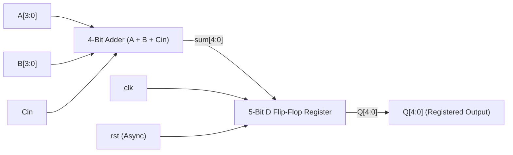

# 4-Bit Full Adder with D Flip-Flop (Verilog HDL)

A digital design project implementing a 4-bit Full Adder with a synchronized 5-bit D Flip-Flop (DFF) output register in Verilog HDL. The design performs binary addition on two 4-bit inputs with a carry-in and registers the result (sum + carry-out) on the positive edge of the clock with asynchronous reset support.

---

## 📌 Architecture Overview

The system consists of two primary stages:
1. **Combinational Adder Stage**: Computes the 5-bit sum (`A + B + Cin`), where bit 4 represents the carry-out and bits `[3:0]` represent the sum bits.
2. **Sequential Register Stage**: A 5-bit D Flip-Flop captures the combinational sum on the rising edge of `clk` or asynchronously resets the output to `5'b00000` when `rst` is asserted high.



---

## 📂 Repository Structure

```text
4bit_fa_dff/
├── adder_dff.v        # Top-level module: 4-bit adder with registered output
├── adder_dfftb.v      # Testbench for functional verification
├── modelsim.ini       # ModelSim configuration file
└── README.md          # Project documentation
```

---

## 🔌 Module Interface & Pinout

### `adder_dff` (Top Module)

| Port Name | Direction | Bit Width | Description |
|-----------|-----------|-----------|-------------|
| `A`       | Input     | 4-bit `[3:0]` | Operand A input |
| `B`       | Input     | 4-bit `[3:0]` | Operand B input |
| `Cin`     | Input     | 1-bit     | Carry-in bit |
| `clk`     | Input     | 1-bit     | Positive-edge system clock |
| `rst`     | Input     | 1-bit     | Asynchronous active-high reset |
| `Q`       | Output    | 5-bit `[4:0]` | Registered output (`Q[4]` = Carry-Out, `Q[3:0]` = Sum) |

---

## ⚙️ Functional Description

### 1. Asynchronous Reset (`rst = 1`)
When `rst` transitions high, the register output `Q` is immediately cleared to zero (`5'b00000`) regardless of the clock state:
$$\text{rst} = 1 \implies Q \leftarrow 5'b00000$$

### 2. Normal Synchronous Operation (`rst = 0`)
On each rising edge of `clk` (`posedge clk`), the 5-bit sum of `A`, `B`, and `Cin` is sampled and stored into register `Q`:
$$Q \leftarrow A + B + C_{in}$$

---

## 🧪 Testbench & Verification

The testbench (`adder_dfftb.v`) generates a clock with a 10 time-unit period (50% duty cycle) and verifies reset behavior and arithmetic addition across different cases:

| Time Step | `rst` | `A` (Binary / Dec) | `B` (Binary / Dec) | `Cin` | Expected Sum (`A + B + Cin`) | Expected `Q` (after clock edge) |
|:---------:|:-----:|:------------------:|:------------------:|:-----:|:----------------------------:|:-------------------------------:|
| **0 - 10** | `1`   | `0000` (0)         | `0000` (0)         | `0`   | `00000` (0)                  | `00000` (Reset State)           |
| **10 - 20**| `0`   | `0011` (3)         | `0010` (2)         | `0`   | `00101` (5)                  | `00101` (5)                     |
| **20 - 30**| `0`   | `0101` (5)         | `0011` (3)         | `0`   | `01000` (8)                  | `01000` (8)                     |
| **30 - 40**| `0`   | `1111` (15)        | `0001` (1)         | `0`   | `10000` (16)                 | `10000` (16)                    |
| **40 - 50**| `0`   | `1010` (10)        | `0101` (5)         | `1`   | `10000` (16)                 | `10000` (16)                    |
| **50 - 60**| `0`   | `1111` (15)        | `1111` (15)        | `1`   | `11111` (31)                 | `11111` (Max Value, 31)         |

---

## 🚀 How to Simulate

### Using ModelSim / QuestaSim (CLI)

1. Open your terminal or ModelSim console in the project root directory.
2. Create the work library:
   ```bash
   vlib work
   ```
3. Compile the design and testbench files:
   ```bash
   vlog adder_dff.v adder_dfftb.v
   ```
4. Run the simulation:
   ```bash
   vsim -c -do "run -all; quit -f" work.adder_dfftb
   ```

### Using ModelSim (GUI)
1. Launch **ModelSim**.
2. Go to **File** $\rightarrow$ **Change Directory...** and select this project folder.
3. In the Transcript window, compile the files:
   ```tcl
   vlog adder_dff.v adder_dfftb.v
   ```
4. Start simulation:
   ```tcl
   vsim work.adder_dfftb
   ```
5. Add signals to the wave window:
   ```tcl
   add wave -r /*
   run -all
   ```

### Using Icarus Verilog & GTKWave (Alternative)
```bash
iverilog -o sim adder_dff.v adder_dfftb.v
vvp sim
```

